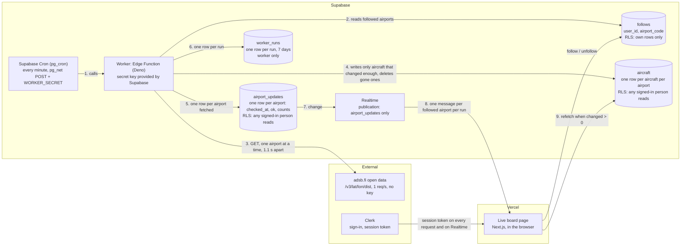

# Live board: the data flow

How live air traffic gets from adsb.fi to the Live board page. Agreed in step 3, before any code. Nothing here changes `trips`, `items` or `profiles`: every table is new.

## Each run, every minute

1. **Supabase Cron** calls the worker with a secret header (`WORKER_SECRET`, kept in Vault and as an Edge Function secret, never in code). The worker refuses calls without it, and runs less than 45 s after the last one.
2. **The worker** reads which airports anyone follows, deduplicated, and fetches each one from adsb.fi, 1.1 s apart, within 30 NM. If more than 10 airports are followed, the 10 checked longest ago go first. At the first 429 it stops, and marks the rest as failed.
3. **It writes only aircraft that changed enough:** a different status or callsign, or a change in altitude (to the nearest 100 ft), speed (10 kt) or distance (0.5 NM). It inserts new aircraft, and deletes one after it has been missing for 2 runs in a row. It also deletes the rows of airports no one follows any more.
4. **It updates one `airport_updates` row** for each airport it fetched, and adds one `worker_runs` row for the run.
5. **Realtime** sends that `airport_updates` change to each open page that follows the airport: one message per followed airport per run. `aircraft` isn't in the publication, so a single aircraft never sends a message.
6. **The page** refetches that airport's aircraft only when `changed > 0`.

## Tables

| Table | One row per | Columns | Who can read and write |
|---|---|---|---|
| `follows` | person and airport | `user_id`, `airport_code` (3 letters, from the curated list), `created_at` | Each person sees, adds and removes only their own, at most 3. No update: you follow or unfollow. |
| `aircraft` | aircraft near an airport | `airport_code`, `hex`, `callsign`, `type`, `altitude_ft` (`null` on the ground), `speed_kt`, `vertical_rate_fpm`, `distance_nm`, `status`, `seen_at`, `missed_runs`, `updated_at` | Any signed-in person reads. Only the worker writes. |
| `airport_updates` | followed airport | `airport_code`, `checked_at`, `ok`, `aircraft_count`, `changed` | Any signed-in person reads, and gets its changes through Realtime. Only the worker writes. |
| `worker_runs` | run, kept 7 days | `id`, `started_at`, `duration_ms`, `airports`, `rows_changed`, `ok`, `error` | Only the worker. |

Anonymous visitors have no grants on any of them.

**Status** is a guess from the aircraft's own data. It says nothing about any flight, and the page says it isn't flight status:
- **on ground:** adsb.fi reports `"ground"`
- **departing:** below 10,000 ft and climbing more than 300 ft/min
- **arriving:** below 10,000 ft and descending more than 300 ft/min
- **overflying:** anything else

## What the page shows

| State | When | What it says |
|---|---|---|
| Loading | Before the first read | Loading rows, the shape of the board |
| No airports yet | The person follows none | Airports to follow, suggested from their trip destinations |
| Fresh | Checked in the last 3 minutes | The board |
| Empty | Fresh, with no aircraft | No aircraft within 30 NM right now |
| Stale | Not checked for 3 minutes (3 missed runs) | The last board, with when it was last updated |
| Down | The last check failed (`ok = false`) | The last board, and that live data is unavailable right now |

The page credits adsb.fi with a link to https://adsb.fi, as its terms require.
