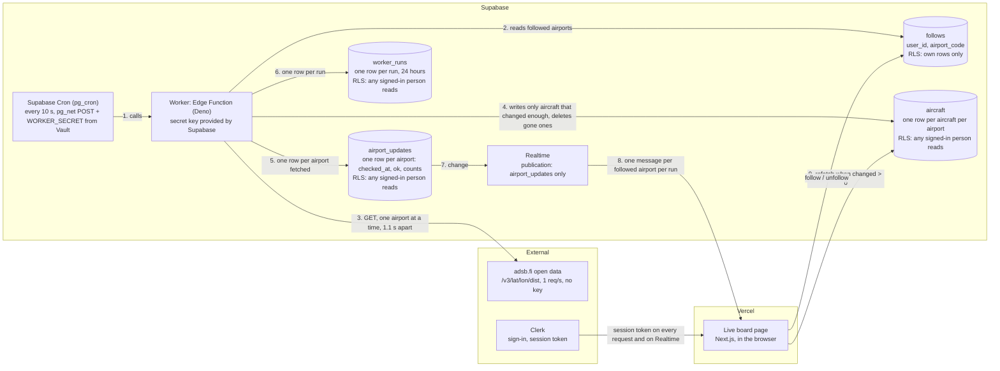

# Live board: the data flow

How live air traffic gets from adsb.fi to the Live board page. Agreed in step 3, before any code. Nothing here changes `trips`, `items` or `profiles`: every table is new.

## Each run, every 10 seconds

1. **Supabase Cron** calls the worker with a secret header (`WORKER_SECRET`, read from Vault each time; also an Edge Function secret; never in code). The worker refuses calls without it, and skips a call that comes under 8 s after the last run.
2. **The worker** reads which airports anyone follows, deduplicated, and fetches each one from adsb.fi, 1.1 s apart, within 30 NM: the ones checked longest ago first, at most 10, and none started after 5.5 s, so a run ends before the next. The rest wait for the next run. A 429 or a timeout is recorded for that airport, and the run goes on; after a 429 it stops asking adsb.fi until the next run.
3. **It writes only aircraft that changed enough:** a different status or callsign, or a change in altitude (to the nearest 100 ft), speed (10 kt), distance (0.5 NM), bearing (5°) or track (15°). It inserts new aircraft, and deletes one after it has been missing for 2 runs in a row. It also deletes the rows of airports no one follows any more.
4. **It updates one `airport_updates` row** for each airport it fetched: always when something changed or a check failed, and otherwise every 30 s (the heartbeat), so a quiet airport doesn't send a Realtime message every 10 s. With more than 5 airports followed, always, because `checked_at` decides which go first. It adds one `worker_runs` row for the run, and deletes runs older than 24 hours.
5. **Realtime** sends that `airport_updates` change to each open page that follows the airport: one message per followed airport per run. `aircraft` isn't in the publication, so a single aircraft never sends a message.
6. **The page** refetches that airport's aircraft only when `changed > 0`.

## Tables

| Table | One row per | Columns | Who can read and write |
|---|---|---|---|
| `follows` | person and airport | `user_id`, `airport_code` (3 letters, from the curated list), `created_at` | Each person sees, adds and removes only their own, at most 3. No update: you follow or unfollow. |
| `aircraft` | aircraft near an airport | `airport_code`, `hex`, `callsign`, `type`, `altitude_ft` (`null` on the ground), `speed_kt`, `vertical_rate_fpm`, `distance_nm`, `bearing_deg`, `track_deg`, `status`, `seen_at`, `missed_runs`, `updated_at` | Any signed-in person reads. Only the worker writes. |
| `airport_updates` | followed airport | `airport_code`, `checked_at`, `ok`, `aircraft_count`, `changed` | Any signed-in person reads, and gets its changes through Realtime. Only the worker writes. |
| `worker_runs` | run, kept 24 hours | `id`, `started_at`, `duration_ms`, `airports`, `airports_failed`, `rows_changed`, `ok`, `error` (short, never a secret) | Any signed-in person reads. Only the worker writes. |

Anonymous visitors have no grants on any of them.

**Status** is what the aircraft is doing, as its transponder reports it, not a flight's schedule; the page says "Live positions from aircraft transponders. Not flight schedules.":
- **on_ground** ("On ground"): adsb.fi reports `"ground"`
- **climbing** ("Climbing"): climbing more than 300 ft/min
- **descending** ("Descending"): descending more than 300 ft/min
- **level** ("Passing over"): anything else in the air

The board lists descending and climbing aircraft first, then those on the ground, then those passing over, nearest first. `bearing_deg` (its direction from the airport) and `track_deg` (the direction it's moving) place each aircraft on the radar.

## What the page shows

| State | When | What it says |
|---|---|---|
| Loading | Before the first read | Loading rows, the shape of the board |
| No airports yet | The person follows none | Airports to follow, suggested from their trip destinations |
| Fresh | Checked in the last 60 s | The board |
| Empty | Fresh, with no aircraft | No aircraft within 30 NM right now |
| Stale | Not checked for 60 s (2 missed heartbeats) | The last board, with when it was last updated |
| Down | The last check failed (`ok = false`) | The last board, and that live data is unavailable right now |

The page credits adsb.fi with a link to https://adsb.fi, as its terms require.

## Where it lives

- **The worker:** `supabase/functions/worker/`: `index.ts` (fetching and writing), `logic.ts` (the rules, tested by `logic.test.ts` on saved adsb.fi responses, `npm run test:worker`) and `airports.ts` (the curated list, also used by the app through `src/lib/airports.ts`).
- **The tables:** `supabase/migrations/20261103085654_create_live_board_tables.sql`.
- **The schedule:** `supabase/migrations/20261103210747_schedule_worker.sql`.
