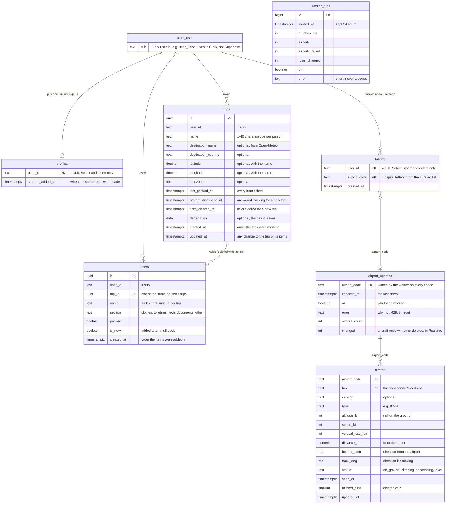

# Data model

Seven tables in Supabase: three for packing lists and four for the Live board ([docs/data-flow.md](data-flow.md)). The SQL is in [`supabase/migrations/`](../supabase/migrations/).

## How each row belongs to one person

1. The browser sends Supabase the person's Clerk session token with every request.
2. Supabase checks the token against Clerk, and `auth.jwt()->>'sub'` is that person's Clerk user id.
3. **Writing:** a new row's `user_id` defaults to that id, so the app never sends it.
4. **Reading and changing:** every table has row-level security. Its select, insert, update and delete policies only match rows where `user_id` is that id. An item can also only point at a trip with the same `user_id`.
5. **Signed out:** with no token, the request runs as `anon`, which has no access to any table.

The forecast is never saved: only where a trip is going, and optionally the day it leaves (`departs_on`, a calendar day from 2000 to 2099). The starter trips are made once per person, by `add_starter_trips()`. Because a profile can't be changed or deleted, deleting every trip doesn't bring them back.

## The Live board's tables

- **`follows` is personal,** like trips: `user_id` defaults to the Clerk id, and each person can select, insert and delete only their own. There's no update, because a follow has nothing to edit. A trigger refuses a fourth follow ("You can follow up to 3 airports"), with a lock so two at once can't both get in.
- **`aircraft`, `airport_updates` and `worker_runs` belong to nobody.** They hold live air traffic, not anyone's data, so they have no `user_id`. Any signed-in person can read them; `anon` gets nothing. Nobody can write them but the worker, which uses the secret key Supabase provides on its own servers.
- **Realtime** publishes only `airport_updates`, one row per airport. A signed-in person gets its changes because of its select grant and policy.
